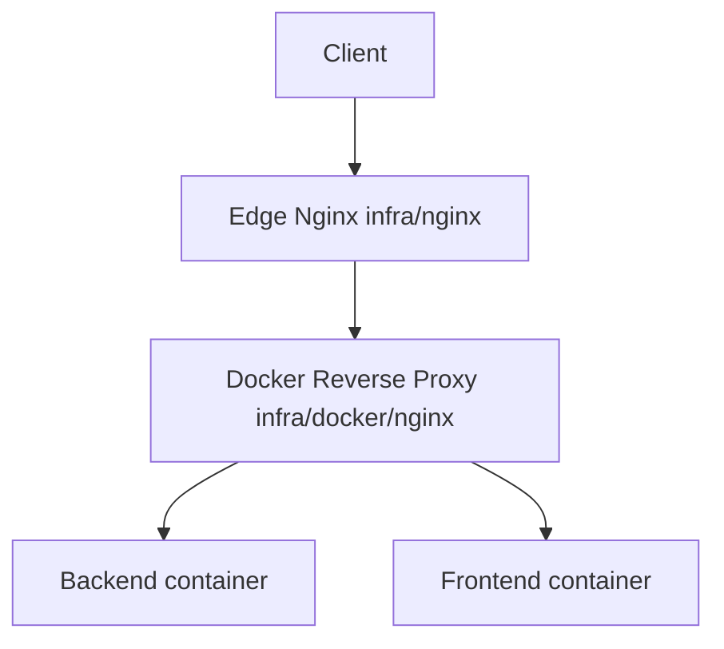
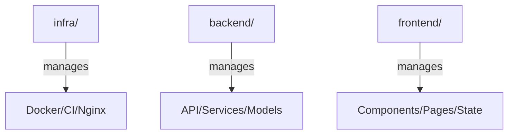

# Architecture

## Infra layout

- `infra/docker/` - Dockerfiles, compose services, and container configs (nginx inside docker/nginx for the reverse proxy container)
- `infra/nginx/` - Standalone nginx config files used by host/edge (nginx-frontend.conf, frontend-nginx.conf)
- `infra/scripts/` - run-tests, setup scripts
- `infra/ci-cd/` - CI/CD definitions

## Nginx difference

`infra/docker/nginx/` configures nginx **inside** the docker container (reverse proxy container).
`infra/nginx/` holds standalone nginx configs applied on host/edge.

## Branch flow

## Layer separation

