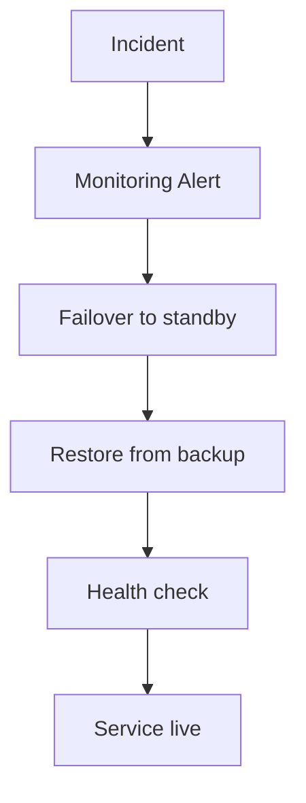

# Disaster Recovery & Business Continuity

## RTO / RPO
- RTO: 15 minutes (service restoration)
- RPO: 5 minutes (data loss tolerance)

## Recovery flow

## Backup strategy
- MongoDB: daily full + hourly incremental (see infra/docker/mongodb)
- Redis: RDB snapshots every 5 min
- Files: replicated to object storage

## References
- Infra: infra/docker/, infra/compose.yaml
- Monitoring: infra/docker/monitoring/
- CI/CD: .github/workflows/
- API: docs/API.md
- DB: docs/DB.md
